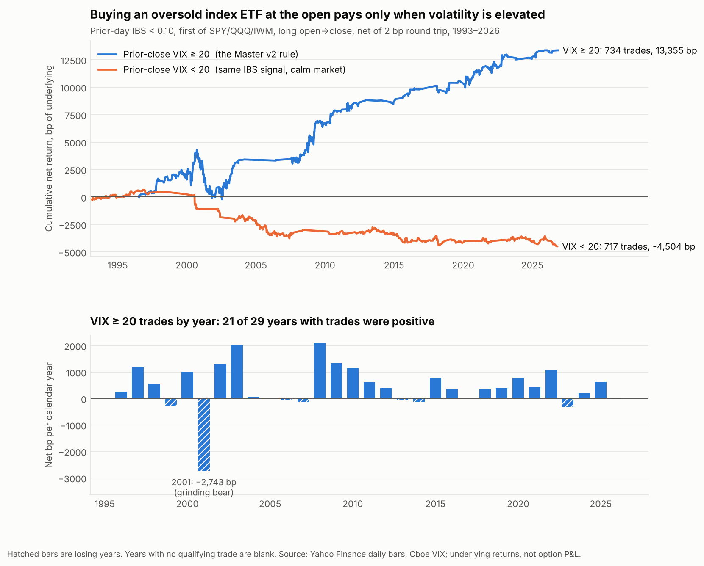
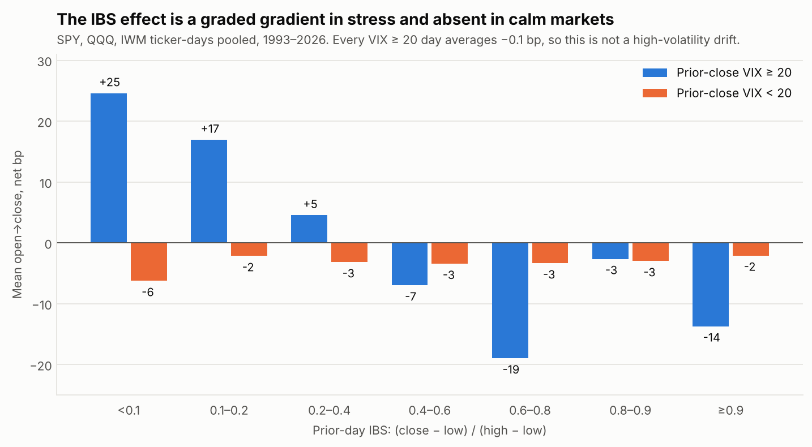

# Master v2 research: regime-gated IBS dip-buy (2026-11-04)

Independent audit of Apex Chronos MASTER v1 and a search for a better "one trade per day" rule. Everything here is reproducible from this folder.

## Verdict in five lines

1. No intraday module (trap fade, breakout follow, midday pin, gap, late-day momentum, RVOL-closest-to-1 ranking) showed an edge on independent data. A 108-rule intraday scan had 0 Holm survivors.
2. Master v1's published +0.306R / PF 1.74 (57 trades) rests on a **hindsight pick** (whole-day ranking). The rule the bot can run live (first signal to fire) returns **-0.020R, PF 0.97, max DD -12.8R** on the reliability profile and +0.165R on the runner profile.
3. The one idea that survived pre-registered testing is **Master v2**: previous VIX close >= 20 AND previous-day IBS < 0.10, take the first of SPY, QQQ, IWM, long at the open, exit at the close, at most one trade per day.
4. v2 on 30 years of daily bars (net of 2 bp round trip): n=734 (24.2/yr), **+18.19 bp/trade**, 95% CI [+5.4, +31.3], hit 56.9%, PF 1.33, max DD -4,506 bp. The same signal with VIX < 20 loses 6.3 bp/trade, so the VIX gate is the whole edge.
5. Treat it as a forward-test candidate, not a proven system. Plan on about half the in-sample edge (about +9 bp). Option P&L is unverified (no historical quotes).

Next-session state at the 2026-11-04 close: VIX 16.61, IBS SPY 0.315 / QQQ 0.289 / IWM 0.550, so v2 says **no trade**.




## Master v2 rule

| Element | Rule |
| --- | --- |
| Regime gate | Previous VIX close >= 20, no upper cap (VIX >= 25 supplied 69.5% of profit) |
| Signal | Previous-day IBS < 0.10, IBS = (close - low) / (high - low) |
| Pick | First of SPY, QQQ, IWM (fixed order) with IBS < 0.10. No RVOL ranking, no lowest-IBS ranking |
| Entry / exit | Long at the open, exit at the close. No intraday stop was tested |
| Frequency | At most 1/day, about 24/yr, clustered in turbulent periods, zero in calm ones |
| Cost assumed | 2 bp round trip on the underlying; breakeven about 20 bp |

## Evidence ledger (net of 2 bp; Holm-corrected; locked specs in `prereg/`)

| Test | Question | Result | Verdict |
| --- | --- | --- | --- |
| H1 | Fade hourly traps (n=1,146) | -2.04 bp | no edge |
| H2 | Follow hourly breakouts | +0.21 bp | no edge |
| H3 | RVOL near 1 beats other days | -1.35 bp, wrong sign | no edge |
| H4a-c | Late-day momentum | about -2 bp gross, 42.5% hit | fails |
| H5a/b | IBS on hourly bars | +10.6 (wide CI) / -6.7 bp | inconclusive |
| H5c | IBS < 0.10, long open to close, daily | +10.14 bp, CI [+2.0, +18.6], Holm p=0.068 | admitted |
| H5d | IBS > 0.90 short | not significant | rejected |
| A5 | Lowest-IBS selection | -0.2 bp | rejected |
| A7 | 108-rule intraday scan | 0 Holm survivors (2 raw p<0.05 vs 5.4 expected) | rejected |
| A8 | RVOL-normalcy vs outcome R, 777 instrument-sessions | Spearman -0.046 to -0.002 | rejected |
| B1 | H5c with previous VIX >= 20 (n=734) | +18.19 bp, p=0.0014 | admitted |
| B2 | VIX split after 5-threshold search | circular-shift p=0.001 (Holm 0.002 for B1 and B2) | admitted |

Robustness (post hoc, labelled): placebo beats 99.98% of random same-size SPY VIX >= 20 draws; walk-forward threshold +19.9 bp (n=397); 21 of 29 years with trades positive; excluding the two best years +14.4 bp, excluding 2008/2020/2022 +15.9 bp; sub-periods 1996-2007 +9.2, 2008-2014 +29.5, 2015-2026 +23.5, 2022-2026 +18.8 bp; IBS threshold sweep smooth (<0.05 +22.0, <0.10 +18.2, <0.15 +12.7, <0.20 +11.1); within VIX >= 20 the IBS effect is monotone and all ticker-days average -0.1 bp, so this is not a high-VIX drift; truncation (no-lookahead) test 25/25 identical; independent `csv`-module recomputation matches.

## v1 versus v2, unit-matched (bp of underlying, net of each strategy's own costs)

| | v1 published (hindsight) | v1 live rule (first signal) | v2 |
| --- | --- | --- | --- |
| Own units | +0.306R, PF 1.74, DD -3.5R (57 trades) | -0.020R, PF 0.97, DD -12.8R (reliability); +0.165R (runner) | +18.19 bp, PF 1.33, DD -4,506 bp (734 trades) |
| Net bp/trade (reliability / runner) | +4.47 / +9.58 | +0.03 / +2.56 | +18.19 |
| Mean z (VIX-implied daily sd units) | +0.047 / +0.100 | +0.001 / +0.029 | +0.089 |
| Hit rate | 70.2% | 57.9% / 47.4% | 56.9% |
| Evidence | 60 sessions of 5-minute bars | same | 30 years of daily bars |
| Regime gate | off at VIX >= 25 | same | on at VIX >= 20 |

v1's VIX >= 25 gate would block 69.5% of v2's profit. v1's IBS bonus is wrong-signed in calm markets (-6.3 bp when VIX < 20), and its RVOL ranking and confidence score (AUC 0.49) have no support.

## Limits and risks

- The VIX >= 20 split was found after seeing first-round data (D2), then pre-registered as Addendum 2 and tested on the same history. Not out-of-sample. About 130 tests were run in total.
- Losses cluster: worst year 2001 (-2,743 bp), max DD -28 z-units, longest losing streak 5, worst trade -685 bp, worst month -933 bp; 65% of 210 active months positive.
- Profit concentrates in stress (VIX >= 25: +23.8 bp/trade vs +11.8 bp for VIX 20-25).
- IWM-triggered trades averaged -10.4 bp (n=112) vs +23.3 bp for SPY/QQQ (n=622). Post hoc; not acted on.
- Entry timing matters (hourly sample, n=26): enter 09:30 +33 bp, 10:30 +11, 12:30 -3.
- The Master's own 5-minute window held 1 pick day with VIX >= 20, so it cannot validate v2.
- No historical option quotes. Model-free fair values (below) need a live quote check before any option trade.

Model-free option fair values on pick days (strikes from the open, sigma = previous VIX / 100 / sqrt(252)): put credit spread short -0.75 sigma width 0.25 sigma, win 83.8%, fair credit 13.7% of width; short -0.50 sigma 76.8% / 20.3%; short -1.0 sigma 88.8% / 9.3%; call debit spread long at the open width 0.5 sigma, fair debit 45.2% of width.

## Forward-test plan (proposal, not backtested)

Built into the bot as `python3 -m apex_master_bot v2-check` (alert-only, `apex_master_bot/apex_master_bot/v2.py`); see the bot README.

Paper-trade every signal day with the ETF as the record; log the live option credit or debit beside it. Pause if forward cumulative net return falls below -1,600 bp (about 2 sd of a 20-trade run). Retire at 40 trades if the mean is at or below zero. Test the IWM exclusion once at 40 trades. No rule edits during the test.

## Reproduce

```
pip install pandas numpy yfinance requests matplotlib
cd research/master_v2
python3 -I src/s04_regime.py data /tmp/out          # B1-B9, writes ibs_pick_order_l1.csv
python3 -I src/s05_controls.py data /tmp/out        # C1-C7 controls
python3 -I src/s06_final.py data ../.. /tmp/out     # final v2 backtest, v1 comparison, integrity checks
python3 -I src/s07_charts.py data /tmp/out          # needs /tmp/out/ibs_pick_order_l1.csv from s04
cmp /tmp/out/master_v2_trades.csv results/master_v2_trades.csv   # identical
```

`data/` holds only what s04-s07 read (SPY/QQQ/IWM daily and hourly bars, VIX, FRED VIXCLS; Yahoo Finance and FRED, through 2026-11-04). `src/fetch.py OUTDIR` re-downloads everything, including the single-name and long-history files that `s02_longhist.py` (H1-H5) and `s03_addendum.py` (A5-A8) need. `src/s01*.py` reproduce the v1 baseline and tie-break from `../../results/exit_variants.csv`.

| Path | Contents |
| --- | --- |
| `prereg/` | Locked specs: PREREG.md and two addenda (hashes recorded in each) |
| `src/` | common.py (loaders, bootstrap, Holm), s01 baseline, s02 H1-H5, s03 A5-A8 and D1-D9, s04 B1-B9, s05 controls, s06 final, s07 charts, fetch.py |
| `results/` | Result JSONs, event files, a7_scan.csv, `master_v2_trades.csv` (734 trades), two charts |

*Research output, not personalized financial advice. Past and simulated performance does not guarantee future results.*
